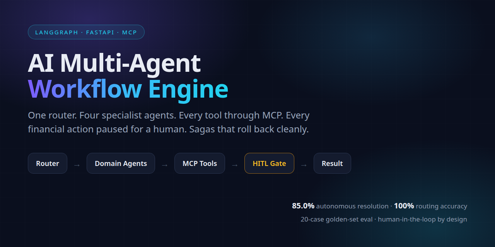
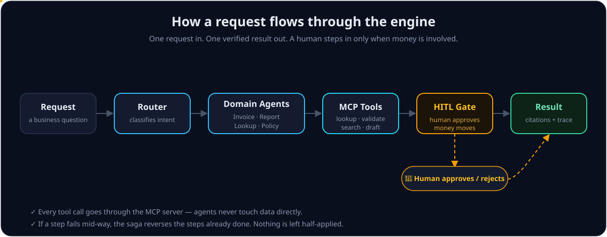
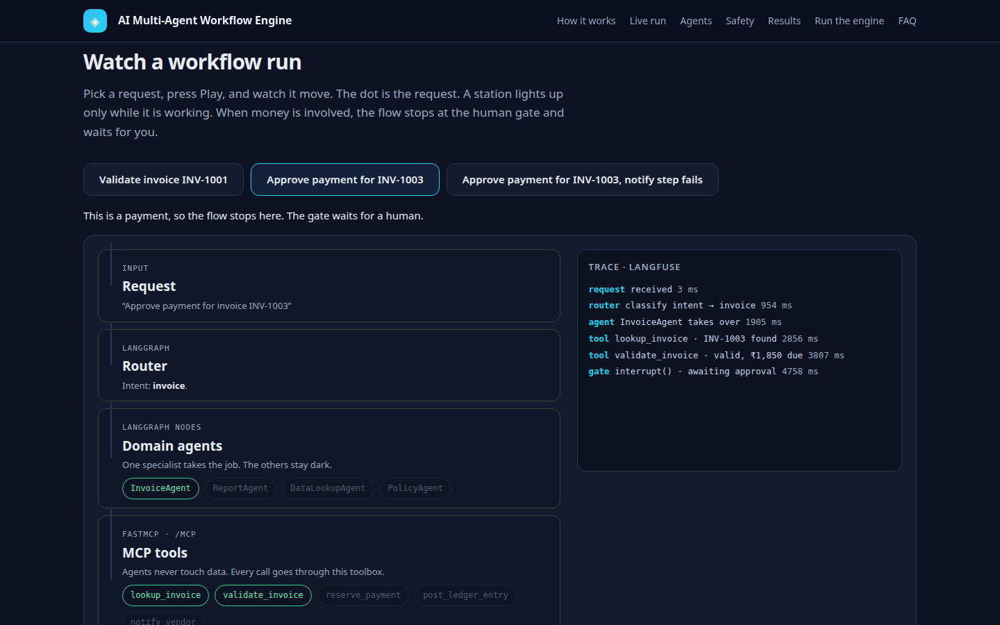
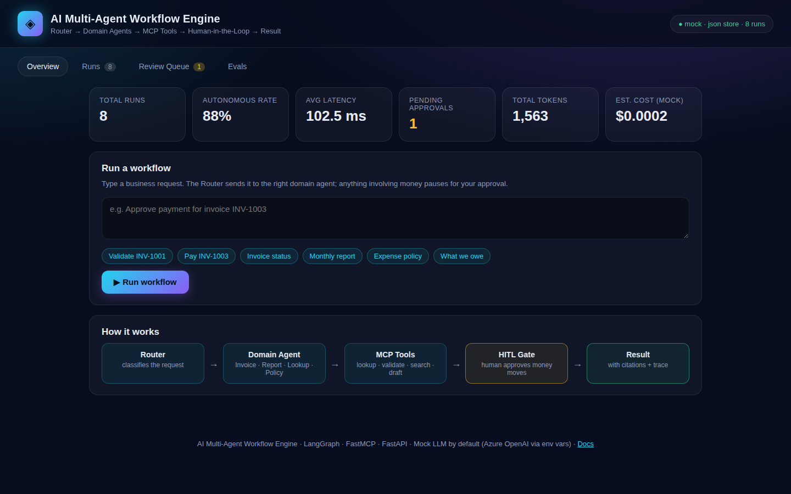
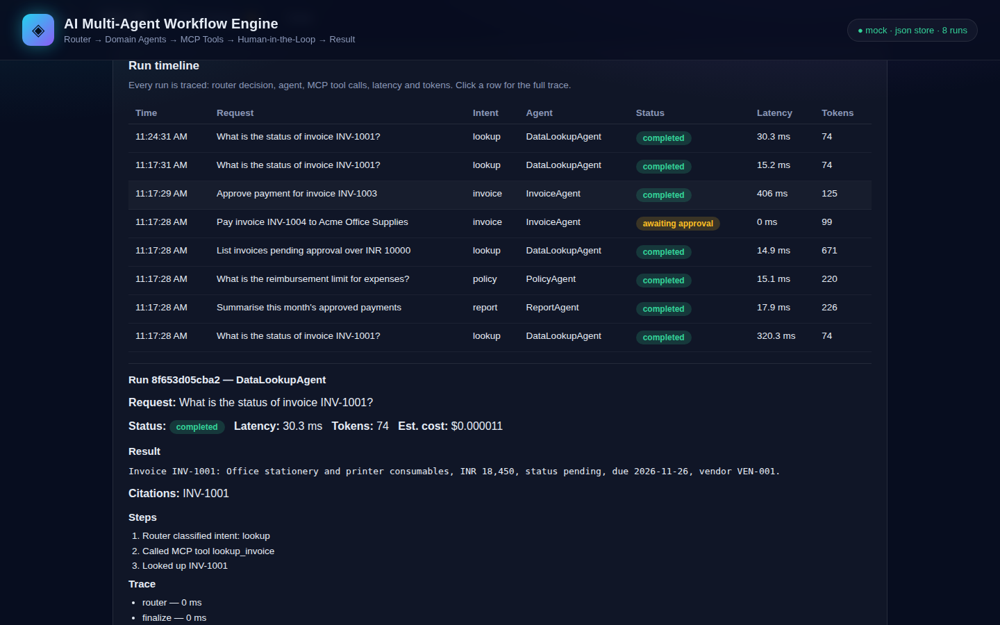
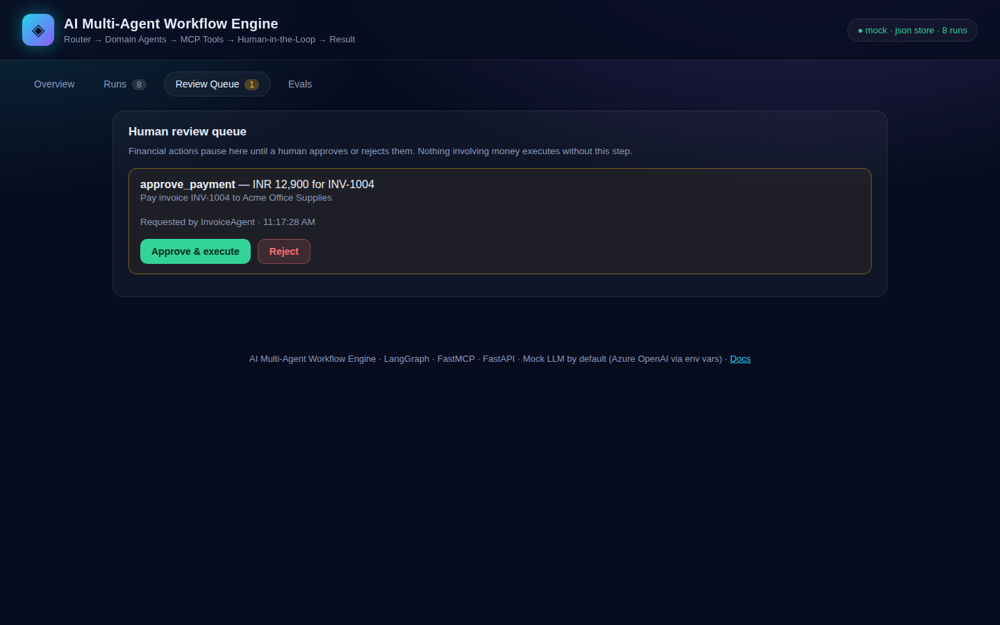
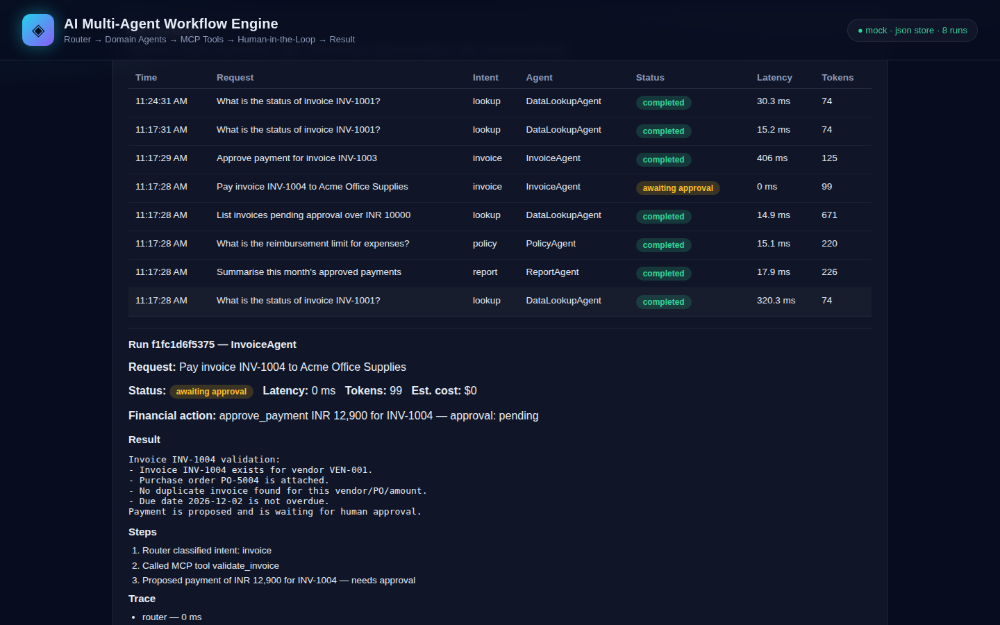
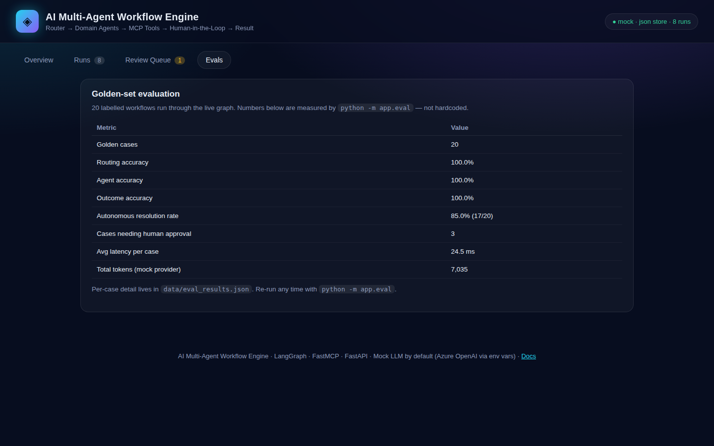

# AI Multi-Agent Workflow Engine

A production-style **multi-agent workflow engine** for business operations: one router classifies each request, four specialist agents do the work through an **MCP tool server**, and any action involving money **pauses for a human** before it executes. Multi-step workflows run as **compensating sagas**, state is **checkpointed** so a killed run resumes without duplicating a side effect, and every run is traced with cost, latency and tokens. An eval harness scores a 20-case golden set and reports a real, measured autonomous-resolution rate.

> 📖 **Docs site (beginner-friendly, animated diagrams):** <https://pronoob-dev.github.io/ai-multi-agent-workflow-engine/>

> **Where this comes from.** This is a clean-room implementation of the Multi-Agent Workflow Engine I built in production at BDO India (LangGraph state machines, MCP tools, HITL gates for financial actions, compensating sagas, Langfuse evals). In production that system resolved **88% of 100+ workflows autonomously** — that is my production result. This repo's own measured number on its 20-case golden set is **85.0%** (see [Eval results](#eval-results)); the two numbers are different things, and this README keeps them separate.

## What it does

Ask it a business question in plain English:

- *"Validate invoice INV-1001"* → the InvoiceAgent checks the invoice (PO match, duplicate, overdue) via MCP tools and answers.
- *"Approve payment for invoice INV-1003"* → the InvoiceAgent validates it, proposes the payment — and **stops**. The payment waits in the review queue until a human approves or rejects it. Nothing involving money executes on its own.
- *"What is the expense reimbursement limit?"* → the PolicyAgent answers from the seeded policy handbook, with citations.
- *"Summarise this month's approved payments"* → the ReportAgent drafts a report from real figures.

## How it works



1. **Router** — a rule-based classifier (mock provider) or an Azure OpenAI model reads the request and picks an intent: `invoice`, `report`, `lookup`, or `policy`.
2. **Domain agent** — one of four specialists takes over:
   - **InvoiceAgent** — invoice intake, validation (PO match, duplicate detection, overdue), payment proposals.
   - **ReportAgent** — report generation from real ledger/invoice figures.
   - **DataLookupAgent** — structured data lookup with citations.
   - **PolicyAgent** — policy/handbook Q&A with RAG over seeded docs.
3. **MCP tools** — every tool call goes through a FastMCP server (streamable HTTP at `/mcp`): `lookup_invoice`, `validate_invoice`, `search_policy`, `draft_report`, `list_vendors`, `reserve_payment`, `post_ledger_entry`, and more. Agents never touch data directly.
4. **HITL gate** — any financial action (`approve_payment`, `issue_credit`, `send_money`) is enforced in code: the LangGraph run calls `interrupt()` and the workflow state becomes `awaiting_approval`. The run cannot proceed until a human approves or rejects it in the review queue.
5. **Compensating saga** — a payment is three steps (reserve → ledger → notify). If any step fails, the saga runs compensations in reverse order (reverses the ledger entry, releases the reservation), so nothing is left half-applied. All steps are idempotent, so resuming a run never double-applies a payment.
6. **Result** — answer with citations, the full step trace, latency, tokens and cost.

State is checkpointed with LangGraph: **PostgresSaver** when `DATABASE_URL` is set, **SQLite** otherwise, in-memory as a last resort. Kill a run mid-payment and restart it — it resumes from the checkpoint, and the payment is applied exactly once (proven by `tests/test_checkpoint.py`).

## Architecture — watch it run

The best way to understand the system is to watch a request move through it. The docs site has a live, playable simulation: a request enters as a dot, the router lights up, the agent calls its tools, a payment stops at the human gate until you approve it, and a failing step runs the saga's undos in reverse.

**Try it:** <https://pronoob-dev.github.io/ai-multi-agent-workflow-engine/#sim> — pick a request and press Play. The three scenarios are: validate an invoice (read-only, no gate), approve a payment (the gate holds, you approve, the saga runs), and approve a payment where the notify step fails (the saga reverses the ledger entry and releases the reservation, so nothing is left half-applied).



Short screen recording of the approve-a-payment run (the gate holds, a human approves, the saga runs): [docs/demo/architecture-sim.webm](docs/demo/architecture-sim.webm)

### The five layers

| Layer | Tech | What it does | Why it is there |
|---|---|---|---|
| Requests in | FastAPI | HTTP API and dashboard. A request arrives as JSON; the answer leaves as JSON with citations and a trace. | One front door. The engine behind it can change without changing the API. |
| Route and run | LangGraph | The router classifies the request; the graph runs the agents as nodes; state is checkpointed after every step. | The workflow is a graph, so its state is visible, pausable and resumable. |
| Specialists | Domain agents | InvoiceAgent, ReportAgent, DataLookupAgent, PolicyAgent. Each owns one kind of work and calls tools through MCP. | One job per agent makes each one easy to test, easy to trust and easy to replace. |
| Tools and memory | FastMCP, PostgreSQL, SQLite, Qdrant | Every data access flows through the MCP tool server. Checkpoints live in Postgres, or SQLite when no database is set. | Agents never touch data directly, so every access is logged in one place, and a killed run resumes exactly once. |
| Proof | OpenTelemetry, Langfuse, eval harness | Every run leaves a trace with latency, tokens and cost. The eval harness scores a 20-case golden set and reports the measured rate. | The numbers in this README are measured by the repo, not claimed in copy. |

### The three safety guarantees, in one paragraph each

**Human-in-the-loop.** A financial action cannot execute without approval. The graph pauses at a LangGraph `interrupt()` and the run waits in the review queue. The only way forward is a human decision. Rejecting leaves zero side effects. Tests prove a payment never runs without approval (`tests/test_hitl.py`).

**Compensating saga.** A payment is three steps: reserve funds, post the ledger entry, notify the vendor. If any step fails, the saga runs compensations in reverse order, and every step is idempotent, so resuming a run never double-applies a payment (`tests/test_saga.py`).

**Checkpoints.** State is checkpointed after every step. Kill the process mid-payment and restart it: the run resumes from the checkpoint and the payment is applied exactly once (`tests/test_checkpoint.py`).

## Dashboard



The dashboard at `/` shows live metrics, a run form, the run timeline with per-run traces, the human review queue, and the eval results.









## Quickstart

```bash
python -m venv .venv && source .venv/bin/activate
pip install -r requirements.txt
uvicorn app.main:app --port 8000
```

Open <http://127.0.0.1:8000>. The mock LLM provider is the default — no keys needed, and the behaviour is fully deterministic.

With Docker (api + Postgres):

```bash
docker compose up --build
```

The API is also available at <http://127.0.0.1:8000/docs> (FastAPI's interactive docs).

## Eval results

Measured by `python -m app.eval` on a 20-case golden set (`data/golden_set.json`), mock provider, run 8 Nov 2026 on this machine:

| Metric | Value |
|---|---|
| Golden cases | 20 |
| Routing accuracy | 100.0% |
| Agent accuracy | 100.0% |
| Outcome accuracy | 100.0% |
| **Autonomous resolution rate** | **85.0% (17/20)** |
| Cases needing human approval | 3 |
| Avg latency per case | 24.5 ms |
| Total tokens (mock provider) | 7,035 |
| Total eval time | 0.6 s |

The 3 cases that need approval are the 3 payment/credit requests in the golden set — by design, those can never resolve autonomously. Per-case detail is in `data/eval_results.json`. Re-run any time with `python -m app.eval`; the numbers above will change if the code changes, and the README should be updated with them — never write a number you did not measure.

## API

| Method | Endpoint | What it does |
|---|---|---|
| `GET` | `/api/health` | Status, LLM provider, store, run counts |
| `GET` | `/api/runs?limit=50` | List runs, newest first |
| `POST` | `/api/runs` | `{"request": "..."}` — run a workflow |
| `GET` | `/api/runs/{id}` | One run with steps, trace, saga log |
| `GET` | `/api/approvals` | Runs waiting for human approval |
| `POST` | `/api/approvals/{id}/approve` | Approve and execute the financial action |
| `POST` | `/api/approvals/{id}/reject` | Reject — no side effects are applied |
| `GET` | `/api/metrics` | Totals, autonomous rate, latency, tokens, cost |
| `GET` | `/api/eval` | Latest measured eval results |
| `POST` | `/api/seed` | Re-seed vendors, invoices and policies |
| — | `/mcp` | The MCP server (streamable HTTP) |

## Configuration

| Variable | Default | What it does |
|---|---|---|
| `DATABASE_URL` | _(unset)_ | Postgres connection string. When set, the store and the LangGraph checkpointer use Postgres; otherwise a JSON file store + SQLite checkpoints. |
| `QDRANT_URL` | _(unset)_ | Qdrant server for policy RAG. Without it, an in-memory vector store is used. |
| `AZURE_OPENAI_ENDPOINT` | _(unset)_ | Azure OpenAI endpoint. Set together with `AZURE_OPENAI_API_KEY` and `AZURE_OPENAI_DEPLOYMENT` to switch from the mock provider to a real model. |
| `AZURE_OPENAI_API_KEY` | _(unset)_ | Azure OpenAI key. Never commit one. |
| `AZURE_OPENAI_DEPLOYMENT` | _(unset)_ | Azure OpenAI deployment name. |
| `OTEL_EXPORTER_OTLP_ENDPOINT` | _(unset)_ | OTLP endpoint for OpenTelemetry traces. Optional. |
| `LANGFUSE_PUBLIC_KEY` / `LANGFUSE_SECRET_KEY` | _(unset)_ | Langfuse credentials for trace export. Optional. |
| `PORT` | `8000` | Server port. |

## Tests

```bash
pytest -q          # 34 tests: routing, MCP tools, HITL, saga rollback, checkpoint resume, eval, API
ruff check app tests scripts
ruff format --check app tests scripts
python -m app.eval # golden-set eval
python scripts/smoke_test.py  # against a running server
```

What the tests prove, not just cover:

- **Routing** — all 20 golden requests classify to the right intent.
- **HITL** — a payment never executes without approval; approving runs the saga (reservation + ledger); rejecting leaves zero side effects.
- **Saga rollback** — a failure in the notify step reverses the ledger entry and the reservation, in reverse order.
- **Checkpoint resume** — a run killed at the approval pause resumes from the same SQLite file in a new process, and the payment is applied exactly once.
- **MCP tools** — duplicate invoices, overdue invoices, the approval threshold, policy search ranking, and idempotency keys are all exercised through the MCP layer.

## Trade-offs and limitations

- **Mock LLM by default.** The router and report drafting are deterministic and rule-based unless Azure OpenAI is configured. With a real model, routing accuracy should be re-measured with `python -m app.eval` before quoting any number.
- **Seed data is fake.** Vendors, invoices and policies are realistic but invented, for demo and eval purposes.
- **Docker path untested locally.** There is no Docker on the machine this was built on, so the `Dockerfile` and `docker-compose.yml` are written from the pinned `requirements.txt` but have not been run end to end. If you run them and hit an issue, please open one.
- **Postgres checkpointer untested locally.** Same reason — no Postgres server here. The `PostgresSaver` path is imported and wired in `app/graph.py`, and the JSON-store Postgres path in `app/store.py` is written the same way, but both were exercised only by import, not by a live database. The default JSON + SQLite path is fully tested.
- **Qdrant backend untested without a server.** Policy search runs on the in-memory vector store by default and is tested that way; the Qdrant backend code is present but needs a live Qdrant instance to verify.
- **Single-process in-memory MCP client.** Agents call the MCP server through an in-process client. The server is also mounted at `/mcp` for external clients, but the agents themselves do not make HTTP calls to it — that keeps the demo fast and dependency-free.
- **Auth.** The dashboard and API have no authentication. Do not expose this on the public internet as-is; put it behind your own auth or run it on a private network.

## Contributing

See [CONTRIBUTING.md](CONTRIBUTING.md). The short version: run `pytest`, `ruff check` and `ruff format` before opening a PR, add a test with any behaviour change, and never let a financial action bypass the HITL gate.

## License

MIT — see [LICENSE](LICENSE). © 2026 Jaikishan Bagul.
